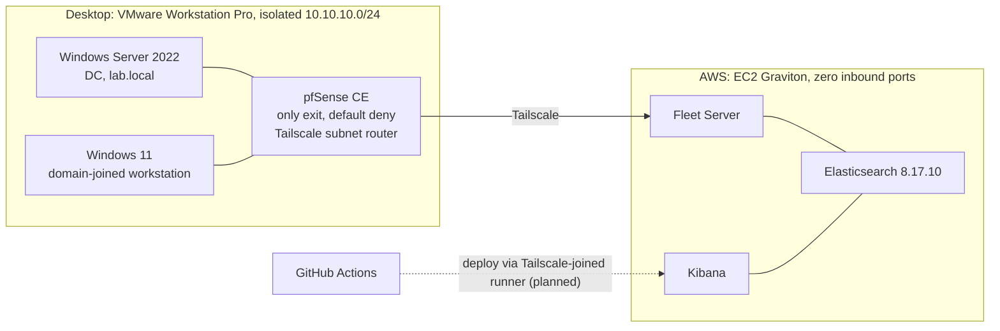
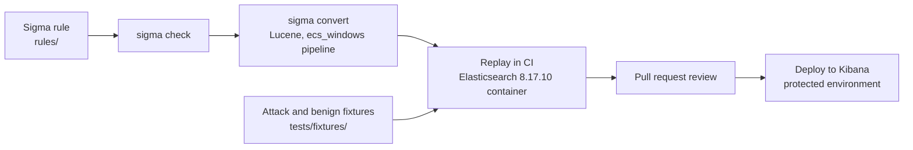

# detection-lab

A detection-engineering home lab built as code. A small Windows Active Directory range on a desktop ships Sysmon and Security telemetry to an Elastic SIEM in AWS; detections are written as [Sigma](https://sigmahq.io/) rules, tested in CI against real captured events, reviewed as pull requests, and deployed to Kibana through a gated pipeline. The end goal is an MCP server and agents that run this loop with a human approving every deploy.

Everything in this repo is reproducible from the instructions below. Nothing in it is a secret: credentials come from environment variables or GitHub secrets, never from files.

## Architecture



- **Range.** Two Windows VMs on a host-only network with no path to the internet except pfSense, whose LAN rules allow exactly two destinations: Fleet (8220) and Elasticsearch (9200) on the SIEM, over Tailscale. Everything else is logged and dropped. Each VM runs Sysmon with the [olafhartong modular config](https://github.com/olafhartong/sysmon-modular) and Elastic Agent 8.17.10, enrolled through Fleet.
- **SIEM.** Elasticsearch, Kibana and Fleet Server in Docker Compose on a t4g.large (Ubuntu 24.04, arm64). The security group has no inbound rules at all; every connection, including SSH, arrives over Tailscale. Fleet and Elasticsearch use certificates issued from the stack's own CA.
- **Identity.** Tailscale ACL tags scope what can talk to what; the SIEM is `tag:siem`, and the range subnet is advertised by pfSense and approved in the admin console.

## How a detection ships



1. **Write the rule** in Sigma, one file per detection, grouped by ATT&CK tactic. Field names are the ones that actually appear in this lab's events, confirmed in Discover, not the ones the documentation suggests.
2. **Capture fixtures.** Run the technique on the range, confirm the event landed on the host (`Get-WinEvent`), then export the real documents from Elasticsearch with `pipelines/export_fixtures.py`. Every rule gets an attack fixture that must fire and benign fixtures that must not. A filter with no benign fixture proving it is needed is a filter nobody will notice breaking.
3. **CI on every pull request** validates each rule (`sigma check`), converts it with the same backend and pipeline used for deployment, and replays the converted query against the fixtures in a throwaway Elasticsearch container, asserting hits on attack events and none on benign ones.
4. **Review.** A human reads the rule and the fixtures. CI proves the rule matches the fixture; the reviewer's job is to confirm the fixture is actually the attack.
5. **Deploy** through a protected GitHub environment with a required reviewer, to the Kibana detection-rules API, from a runner that reaches the SIEM only over Tailscale.

## Repository layout

```
rules/                 Sigma rules, one directory per ATT&CK tactic
tests/fixtures/        Captured events: attack_*.json must fire, benign_*.json must not
tests/mappings/        Snapshot of the production field mapping used by CI   (planned)
tests/cases/           Per-rule test manifests tying rules to fixtures         (planned)
pipelines/             export_fixtures.py, replay.py, deploy.py
iac/                   Terraform, Packer and Ansible for the range and SIEM    (planned)
.github/workflows/     CI and deploy workflows
```

## Running locally

Requires [uv](https://docs.astral.sh/uv/). Python 3.14 is pinned in `.python-version`; uv installs it.

```powershell
uv sync --locked

# validate and convert every rule (the two excluded validators are explained in ci.yml)
uv run sigma check --fail-on-issues -x attacktag -x d3_fendtag rules/
uv run sigma convert -t lucene -p ecs_windows rules/

# export fixtures from the SIEM; credentials only ever come from the environment
$env:ES_URL = "https://<siem-tailscale-ip>:9200"
$env:ES_API_KEY = "<encoded API key with read on logs-*>"
uv run pipelines/export_fixtures.py --query 'event.code:4624 AND winlog.event_data.LogonType:3' --minutes 30 --out tests/fixtures/example.json
```

## Detections

| Rule | Technique | Status |
|---|---|---|
| [Non-admin user network logon to domain controller](rules/lateral_movement/non_admin_dc_logon.yml) | [T1021](https://attack.mitre.org/techniques/T1021/) Remote Services | experimental, fixtures captured |

## Status

- [x] Range: pfSense, DC, workstation, Sysmon and Elastic Agent shipping telemetry
- [x] SIEM: Elasticsearch, Kibana, Fleet Server; zero inbound, Tailscale only; TLS from the stack CA
- [x] First rule with attack and benign fixtures captured from real events
- [x] CI: validate and convert every rule on every pull request
- [ ] CI: Elasticsearch service container and fixture replay with assertions
- [ ] Production field-mapping snapshot so CI queries the same field types as Kibana
- [ ] GitHub App identity for automation (Contents and Pull requests only)
- [ ] Protected `production` environment, Tailscale-joined runner, deploy to the Kibana rules API
- [ ] Infrastructure as code for the range and SIEM
- [ ] MCP server exposing stimulus, export and replay as tools; agents that draft rules and open PRs

## Notes from the build

Things that cost real time and are now encoded in the rules, scripts or workflow:

- `host.name` is already a `keyword` field in these indices, so `host.name.keyword` does not exist and querying it silently returns nothing. `winlog.event_data.TargetUserName` is analyzed text, so an exact match or `endswith: '$'` needs the `.keyword` sub-field. Field types are checked against the mapping, not assumed.
- `WorkstationName` is blank in Kerberos network logons; the source host is in `winlog.event_data.IpAddress`. A single `net use` produces dozens of 4624 events because Kerberos re-authenticates per service ticket.
- A stimulus that reuses a cached session or ticket produces no new event. Attack jobs clear state first (`net use * /delete /y`, `klist purge`) and verify the event on the host before anything is exported.
- Fleet Server must share Elasticsearch's network namespace in Compose, and agents must be assigned an output that resolves from the range, not the Compose-internal hostname. Healthy agents with no data means the wrong output.
- pySigma 1.5.x's ATT&CK tag validator compares Sigma tactic tags (`lateral_movement`) against STIX shortnames (`lateral-movement`) and rejects every multi-word tactic; it is excluded in CI with a comment explaining why.
- Elastic API keys: authenticate with the `encoded` value from the create response, not `api_key` or `id`.

## Security posture

- No inbound ports anywhere: the SIEM's security group is empty, the range sits behind a default-deny firewall, and all three tiers are reachable only over Tailscale.
- The CI token is scoped to `contents: read`. Deploys will use a dedicated GitHub App and a protected environment with a required reviewer; nothing deploys on a green check alone.
- Fixtures are real events from an isolated lab domain and contain lab-private addresses and account names only. The export script reads credentials from the environment and the repo ignores `.env`, keys and certificates.
